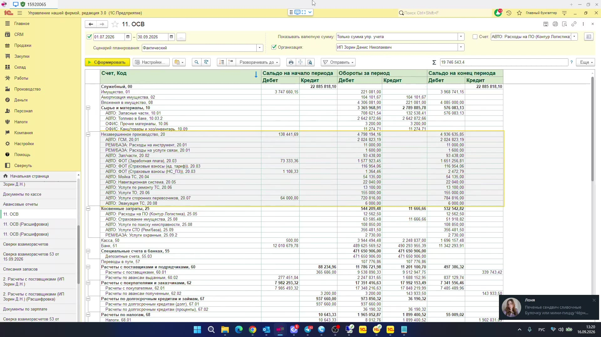
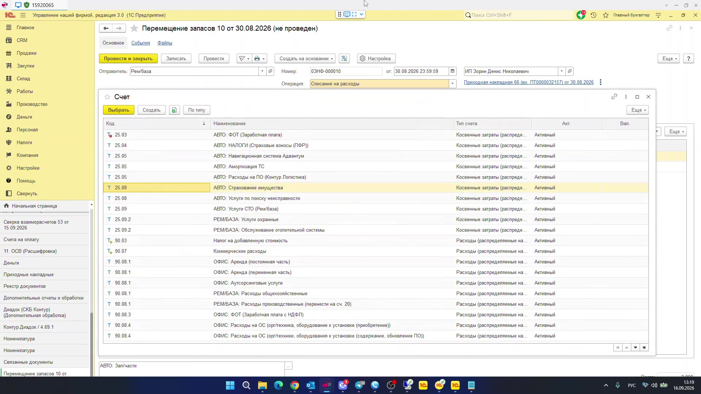
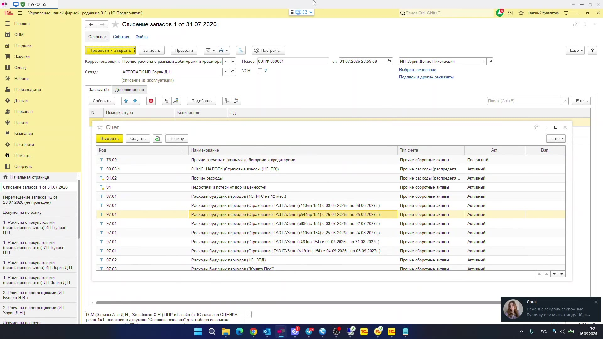
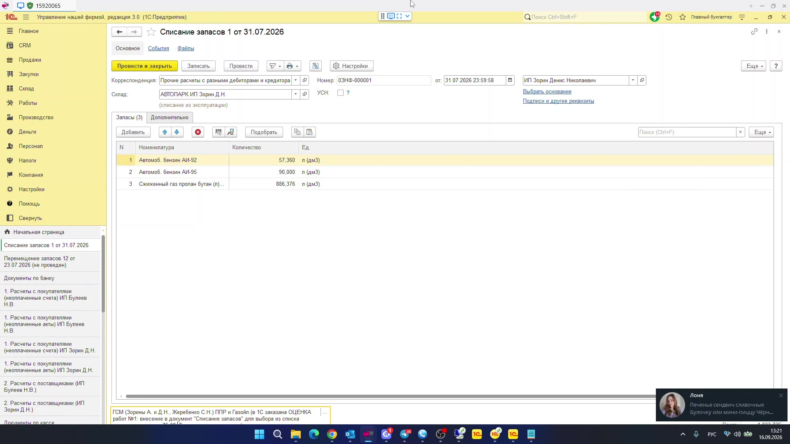
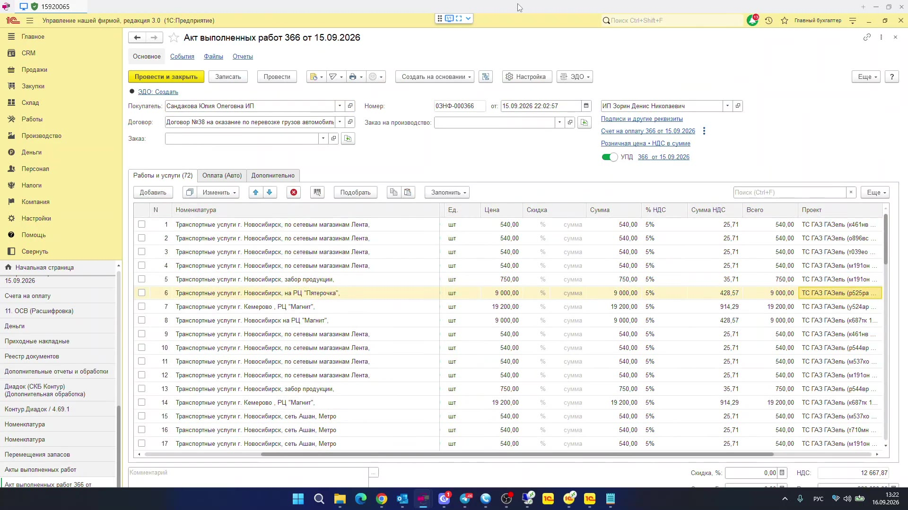

# Анализ сбора требований: списание затрат и ГСМ в УНФ 3.0

Источник: видеозапись созвона ~9 мин 43 сек (16.09.2026).  
Участники: Владимир (специалист 1С, «Первый Бит») и Ирина Петровна (главный бухгалтер заказчика).  
Конфигурация на записи: **1С:Управление нашей фирмой, редакция 3.0**, файловая ИБ `15920065`.

---

## Карточка созвона

| Параметр | Факт с записи |
|---|---|
| Заказчик | Грузоперевозки (Новосибирск и Кемерово), сети «Лента», «Пятёрочка», «Магнит», «Ашан», «Метро» |
| Организации в базе | ИП Зорин Денис Николаевич, ИП Булеев Николай Валерьевич |
| Контакт бухгалтера | Ирина Петровна, +7 (951) 878-57-29 |
| Канал заявки | Bit.Desk, передача от Анны Герасименко / менеджера `@Katok323` |
| Контур | Файловая база на ПК бухгалтера; остальные подключаются к нему (в офисе и через публикацию). Отдельного сервера нет |
| Связанные системы | Куплена «1С:Бухгалтерия» ~25–27 июля, синхронизация в процессе настройки. В комментариях к документам — ППР и Gazol |
| Срок со стороны заказчика | Закрытие августа и выгрузка в бухгалтерию до старта отчётного периода. Оценка — до конца пятницы |

---

## Бизнес-цели

Главная цель заказчика — **получить корректный финансовый результат и себестоимость грузоперевозок в разрезе машин (проектов) и направлений**, чтобы затем выгрузить уже «правильные» данные в 1С:Бухгалтерию и закрыть месяц.

Это не две разрозненные «кнопки в документах», а одна управленческая модель:

1. Прямые затраты рейса (ГСМ, запчасти, ФОТ водителя, услуги СТО) должны попадать в себестоимость конкретной машины / направления, а не растворяться в управленческих расходах 90.08.
2. Личное изъятие ГСМ собственниками (Зорины А. и Д.Н., Жеребенко С.Н.) **не должно** увеличивать себестоимость перевозок: это вывод активов из бизнеса (в терминах бухгалтера — «в счёт дивидендов»).

На ОСВ за 01.07–30.09.2026 по ИП Зорин Д.Н. уже видно разрыв методики:

- выручка 90.01 ≈ 8,5 млн;
- себестоимость продаж 90.02 ≈ 54 тыс.;
- на 20-м счёте «висит» ≈ 4,9 млн без кредитового оборота (ГСМ 20.01 ≈ 2,0 млн, ФОТ 20.03 ≈ 1,6 млн и т.д.);
- часть затрат уходит на 25 и 90.08.

То есть система уже копит прямые затраты, но **не закрывает их на себестоимость услуг**.

---

## Функциональные требования

### AS-IS (как работает сейчас)

1. Закупки ТМЦ оформляются **приходными накладными** (склады «Рембаза», «Автопарк», «Офис»).
2. Списание материалов / ГСМ / запчастей на затраты идёт документом **«Перемещение запасов»**, операция **«Списание на расходы»**, с указанием статьи (счёта затрат) и проекта.
3. В выборе счёта затрат типовой отбор УНФ показывает только типы:
   - «Косвенные затраты» (25);
   - «Расходы» (90.07 / 90.08).
   Счета типа «Незавершенное производство» (20) в списке нет: это не ошибка базы, а параметры выбора реквизита `СчетЗатрат` в `Документ.ПеремещениеЗапасов`.
4. Часть затрат бухгалтер всё же относит на 20.xx (ФОТ, часть ГСМ/запчастей — счета заведены: 20.01 «АВТО: ГСМ», 20.02 «АВТО: Запчасти», 20.03 «АВТО: ФОТ» и др.), но **закрытие 20 → 90.02 не выполняется**: кредитовый оборот по 20 пустой.
5. Производственный контур «как производство продукции» не используется: деятельность — услуги грузоперевозок. Пункт «Производство» в меню есть, но блок не задействован.
6. Аналитика «машина = проект» уже ведётся. В акте выполненных работ по строкам указаны ТС («ТС ГАЗ Газель …») как проекты.
7. Личное ГСМ собственников списывают документом **«Списание запасов»**. Сейчас корреспонденция — 76 «Прочие расчеты с разными дебиторами и кредиторами». В выборе корреспонденции типовой отбор — только типы «Прочие расходы» (91.02) и «Прочие оборотные активы» (94, 97). Счёт 75 в список не попадает — это параметры выбора реквизита `Корреспонденция` в `Документ.СписаниеЗапасов`.
8. Учёт по проектам включён. Синхронизация с бухгалтерией куплена, но «моделирование отражения операций» ещё не закончено.
9. База файловая, на компьютере бухгалтера.

### TO-BE (что хочет заказчик)

1. Списывать материалы, ГСМ, запчасти **на 20-й счёт как прямые затраты** услуги грузоперевозки, а не на 25/90.08.
2. После накопления на 20 — закрывать их так, чтобы получались:
   - правильный финансовый результат;
   - отчёт по себестоимости **по направлениям перевозок**;
   - себестоимость **по каждой машине** (проект): свои ГСМ, запчасти, зарплата водителя.
3. Проект должен «тянуться» по всей цепочке документов (закупки → списания → акты/выручка).
4. ГСМ, изъятый собственниками, относить **в счёт дивидендов (75)**, а не в затраты рейса.
5. Цепочка задач поэтапная: сначала 20-й (и 75-й в списании запасов), затем следующие ступени до закрытия месяца и выгрузки в бухгалтерию.

Формулировка заказчика на записи: «нам надо сначала списать на двадцатый счёт… а потом уже следующий двадцатый будет нападать, и всё остальное».

---

## Спорные моменты и вопросы

1. **ИП и «дивиденды».** В базе две организации — ИП, не ООО. Для ИП юридически это изъятие средств/имущества собственником, а не дивиденды. Нужно зафиксировать: кто именно «руководители» (Зорины А. и Д.Н., Жеребенко С.Н.) относительно каждого ИП, есть ли трудовые отношения, как это должно выглядеть в БУ и для УСН.
2. **Что считать единицей себестоимости:** машина (проект), направление/маршрут, заказ/акт, рейс? На записи одновременно звучат «направление грузоперевозок» и «каждая машина». Машина иногда едет «по другим направлениям».
3. **Как 20 должен закрываться.** Без выпуска услуг / распределения затрат 20 в УНФ не превращается в 90.02. Это уже происходит: 4,9 млн зависли. Заказчик просит «включить 20 в список», не описывая механизм закрытия.
4. **Откуда уже есть обороты по 20.01 ГСМ и 20.02 Запчасти**, если в «Перемещении запасов» тип НЗП выбрать нельзя? Нужно разобрать конкретные документы: ручные операции, смена типа счёта после проведения, зарплата, услуги поставщиков.
5. **Нормы списания ГСМ.** Списание «как пришло» vs по путевым листам / литрам / километражу. В комментарии фигурируют ППР и Gazol — это отдельный контур, его не обсудили.
6. **НДС 5% в актах и признак УСН в шапке документов.** Нужна учётная политика: УСН / НДС, раздельный учёт, как ГСМ и запчасти влияют на налог, если часть уходит собственникам.
7. **Два ИП в одной базе.** ГСМ и запчасти по «Автопарк ИП Зорин» и «Автопарк ИП Булеев». Нужны правила, когда ТМЦ и выручка разных ИП не должны смешиваться, и как это уйдёт в две бухгалтерии.
8. **Состав «прямых» vs «косвенных».** Сейчас 25.xx — амортизация ТС, страхование, Контур Логистика, услуги СТО; 20.xx — ГСМ, запчасти, ФОТ. Граница не согласована.
9. **Объём доработки vs типовая методика.** Заказчик формулирует задачу как «добавить 20 и 75 в выпадающий список». Это ломает типовые отборы и не решает закрытие месяца.
10. **Живая файловая база.** Снятие копии во время работы пользователей, выгрузка dt/архива на ПК бухгалтера, отсутствие сервера и регламента бэкапа.

---

## Дополнительные работы

Имеет смысл продавать не «галочку в списке счетов», а контур, без которого цель заказчика не достигается.

1. **Методика закрытия месяца и себестоимость услуг по проектам (машинам).** Настройка распределения 20/25 → себестоимость, проверка цепочки «акт / заказ → проект → затраты», отчёт «себестоимость по ТС и направлениям», тестовое закрытие августа. Без этого 20-й счёт так и останется «котлом».
2. **Контур ГСМ: путевые листы / обмен с ППР и Gazol, разделение служебного и личного топлива.** Сейчас личное ГСМ вырезается ручным «Списанием запасов». Это регулярный процесс и источник ошибок в налоге и себестоимости.
3. **Правила обмена УНФ → 1С:Бухгалтерия.** База БП куплена в июле и ещё не обкатана. Нужно согласовать маппинг 20/25/90/75/76, чтобы управленческая модель не разъехалась с регламентированным учётом при первой же выгрузке.

---

## Ошибки специалиста 1С

1. **Принял симптом за постановку.** Не показал, что 20 в «Перемещении запасов» и 75 в «Списании запасов» отсекаются типовыми `ChoiceParameters`, и что проведение этих документов заточено под 25/90.08 и 91.02/94 — а не под НЗП и расчёты с учредителями. Не раскрыл ОСВ: 20-й **уже используется и не закрывается** (~4,9 млн). Обещание «добавим счета в список» не даёт себестоимость услуг.
2. **Не задал обязательные вопросы аналитика.** Не зафиксировал систему налогообложения и природу «дивидендов» у ИП; не спросил, как закрывать 20 (на какой объект: акт, заказ, номенклатура услуги, проект-машина); не разобрал, какими документами уже сформированы 20.01/20.02; не спросил про нормы ГСМ, путевые листы, ППР/Gazol; не проговорил раздельный учёт двух ИП.
3. **Не отработал риск срока и контура.** Заказчик явно просит закрыть август «за недельку». Специалист пообещал оценку к пятнице, но не обозначил, что без методики закрытия месяца и синхронизации с БП оценка «двух счетов» бессмысленна. Копию файловой базы снял в ходе звонка, не уточнив, работают ли другие пользователи.

---

## Варианты типового решения

Задачу **стоит решать**, но **не доработкой выпадающих списков**. Цель — себестоимость услуг и чистое изъятие ГСМ собственниками. Это закрывается типовой УНФ, если договориться о методике.

### Вариант 1 (рекомендуемый). Типовая УНФ без производства: прямые расходы + проекты

Пошаговая инструкция отдельно по «Перемещению запасов» и по «Списанию запасов»: [analiz-sozvon-spisanie-zatrat-variant-1.md](analiz-sozvon-spisanie-zatrat-variant-1.md).

Оставить списание ТМЦ документом «Перемещение запасов / Списание на расходы».

- Служебные ГСМ и запчасти — на статьи типа **«Расходы»** с направлением, которое заказчик считает себестоимостью перевозок (отдельная группа 90.02-подобных статей либо 90.08 с аналитикой «АВТО»), **обязательно с проектом = ТС**.
- Личное ГСМ — «Списание запасов» на **91.02 «Прочие расходы»** (статья «Изъятие собственником») либо оставить 76 с последующим зачётом против расчётов с собственником. Это типовые типы корреспонденции, 75 не нужен.
- Себестоимость по машинам смотреть типовыми отчётами по проектам / доходам и расходам, а не «как в бухгалтерии по 20-му».
- 25-е счета с базой «на себестоимость продукции» для услуг без выпуска **не закрываются** — их нужно перевести в тип «Расходы» либо не использовать.

Плюс: без доработок, быстро для закрытия августа.  
Минус: в ОСВ не будет классической схемы 20 → 90.02; бухгалтеру нужно принять, что УНФ — управленческий план счетов, не копия БП.

### Вариант 2. Типовое «производство услуг»: настоящий 20-й и закрытие в 90.02

Если заказчик принципиально хочет именно счёт 20 и себестоимость продаж:

- включить подсистему производства (для **услуг**, не для выпуска изделий);
- прямые материалы/ГСМ относить документами, которые умеют НЗП: **заказ-наряд / производство (сборка запасов)** по выпуску услуги, а не «Перемещение запасов / Списание на расходы»;
- выпуск услуги (номенклатура «Транспортные услуги») закрывает 20 на 90.02;
- проект-машина остаётся аналитикой выпуска и затрат;
- закрытие месяца настраивается и прогоняется на копии.

Плюс: ближе к ожидаемой бухгалтером картине 20 → 90.02.  
Минус: это внедрение контура, а не «два поля в форме»; текущие 4,9 млн на 20 нужно отдельно разбирать. Доработка выбора счетов в «Перемещении запасов» здесь **не нужна и вредна**: документ не предназначен для НЗП.

### Вариант 3. Не делать (или сильно сузить) кастом по 75-му

Добавлять счёт 75 в «Списание запасов» не стоит:

- для ИП это не дивиденды;
- типовой документ не формирует расчёты с учредителями;
- в БП изъятие ТМЦ всё равно придётся интерпретировать отдельно при обмене.

Достаточно типового 91.02 / 76 плюс, при необходимости, ручной операции в бухгалтерии после выгрузки. Если позже понадобится именно 75.02 в УНФ — это отдельная операция «начисление доходов собственникам» (деньгами), а не списание бензина из выбора счетов.

---

## Вывод для оценки

| Что просит заказчик | Что нужно делать |
|---|---|
| «Добавить 20-й в перемещение запасов» | Не делать как доработку. Выбрать вариант 1 или 2 и настроить документы/типы счетов |
| «Добавить 75-й в списание запасов» | Не делать. Типовое списание на 91.02 или 76 |
| «Правильный финрез и себестоимость по направлениям/машинам» | Да, это основной объём: методика, закрытие месяца, проекты, тестовый прогон августа, затем правила обмена в БП |

Первый шаг после оценки — не код, а **учётная политика в УНФ на одном закрытом месяце** (август) по одному ИП.
